# Heston calibration and autocallable pricing on the live SPX surface

Calibrate the Heston model to a live S&P 500 option surface, price a real BNP Paribas Athena autocallable note by Monte Carlo, and benchmark that price with an independent two-dimensional finite-difference solver. Then stress every modelling choice along the way: five volatility models, six calibration objectives, twelve optimisers, seven vanilla pricing engines, four Monte Carlo schemes, local-vol and local-stochastic-vol dynamics, and the hedging-cost reserves a desk would charge on top of the model price.

Everything below is reproducible from the notebooks in this repository. Figures are in `figures/`, every number is in `docs/FACT_SHEET.md`, and every experiment that was tried, including the ones that lost, is in `docs/RESULTS_SUMMARY.md`.

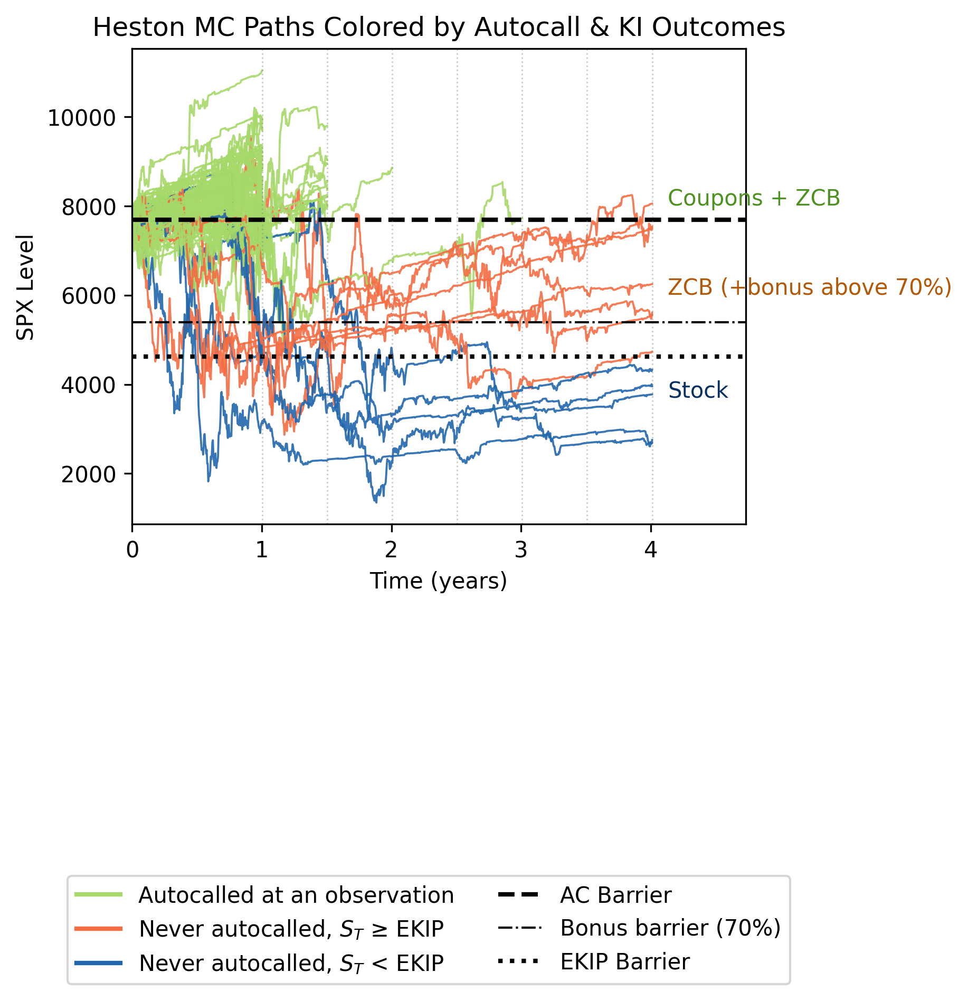

## Headline numbers

Live snapshot of 30 September 2026, SPX 7,696.50 at 15:22 New York. Monte Carlo on 50,000 Andersen QE paths with daily steps, seed 42. Per 1,000 notional.

| | |
|---|---|
| Heston parameters (fit to 6M to 4.2Y, spread-weighted vol objective) | kappa 2.87, theta 0.0527, sigma 1.53, rho -0.61, v0 0.0247 |
| Implied-vol RMSE: all expiries / 6M+ / at the note's strikes | 1.08 / 0.62 / 0.16 vol points |
| Note fair value, Monte Carlo | **975.40 = 97.54%** (s.e. 0.70) |
| Same note on the 2-D Heston PDE | 976.19 (1.1 s.e. away) |
| Legs: principal / coupons / knock-in put | 928.7 / 71.6 / -24.9 |
| Fair coupon at par | 4.03% per semester (term sheet pays 3%, leaving 2.46% for the issuer) |
| Autocalled on any date / loss at maturity / expected life | 87.0% / 4.9% / 1.57 years |
| Delta / cash gamma / vega, client seat | 15.7% of notional / -12.1 per 1% / -0.57 per vol point |
| Model-risk reserve (local vol vs LSV on the same vanillas) | 12.7 per 1,000 = 1.27% of notional |

**What the study found, in one screen**

- A price objective (version 1 of this project) and a vol objective (version 2) land on different Heston parameters. The vol objective fits the note's strike region twice as well (0.16 against 0.22 vol points) and that, not the quote filter or the simulation scheme, is where the v1-to-v2 improvement came from.
- 93% of Heston's squared vol error sits in the first six months. From one year out the fit is inside the bid/ask width. The 4.2Y slice is a data floor (quotes 4.5 vol points wide), not a model failure: every model lands at 0.8 to 0.95 there.
- Bates, double Heston and rough Heston fit the vanillas better (double Heston four times better) and price the note within one point of Heston. Vanilla fit quality is not the risk in this product.
- The risk is the dynamics. Local vol and LSV reprice the same vanillas and differ by 12.7 per 1,000 on the note because they imply different forward skews. That gap is the model-risk reserve.
- `scipy.optimize.least_squares` on the residual vector reaches the same optimum as differential evolution in 0.9 s instead of 65 s. Carr-Madan and COS are 100 times more accurate than the Lewis FFT plus spline at the same cost.
- The Feller condition is violated by a factor of eight. This was investigated as a possible bug and is not one: the kappa-sigma ridge has a real minimum, the COS engine finds the same optimum, and enforcing Feller costs two vol points of fit everywhere and 4.5 per 1,000 on the note.
- The 2-D PDE agrees with Monte Carlo on the total and on every leg within one standard error, and reproduces the closed-form limit case to 0.13.

## Contents

1. [The product](#1-the-product)
2. [Pipeline](#2-pipeline)
3. [Market data](#3-market-data)
4. [Calibration](#4-calibration)
5. [Pricing and validation](#5-pricing-and-validation)
6. [Risk: Greeks, hedging costs, model risk](#6-risk-greeks-hedging-costs-model-risk)
7. [From version 1 to version 2](#7-from-version-1-to-version-2)
8. [Repository map](#8-repository-map)
9. [Reproduce](#9-reproduce)
10. [Caveats](#10-caveats)
11. [References](#11-references)

## 1. The product

A BNP Paribas Athena autocall on the S&P 500 (the term sheet is in `docs/`), re-struck at the snapshot spot so the note is priced as if issued today.

| Term | Value |
|---|---|
| Maturity | 4 years, seven semi-annual observation dates from year 1 |
| Autocall | if the index is at or above 100% of its initial level on an observation date, the note redeems at par plus a snowball coupon of n x 3% (n = number of semesters elapsed) |
| Final redemption | 124% if the index is at or above 70%; 100% if between 60% and 70%; the index performance if below 60% (European knock-in) |
| Payment lag | 7 calendar days after each valuation date |

The note is a zero-coupon bond plus a strip of autocall digitals at 100%, plus a 24% digital at 70%, minus a 60% put and a 40% digital put at 60%. The Monte Carlo prices each leg on the same paths and they add up exactly to the fair value.

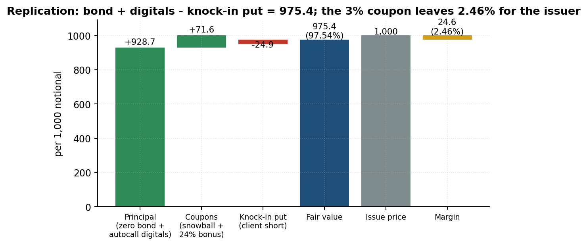

## 2. Pipeline

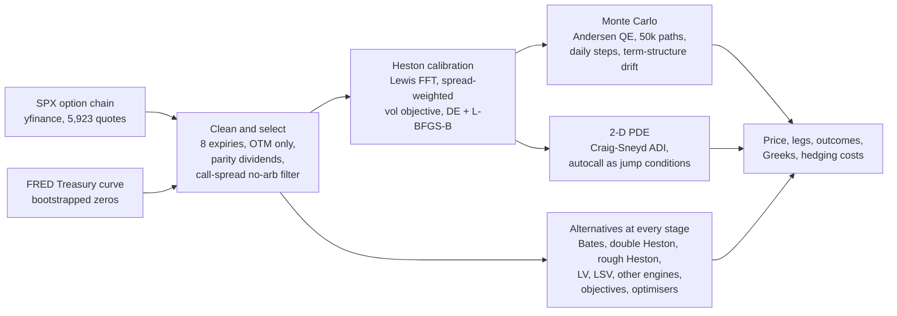

Each stage lives in its own notebook so the pieces can be re-run independently. `main.ipynb` is the full v2 pipeline on the live snapshot. The comparison notebooks take the same cleaned data and swap one stage at a time.

## 3. Market data

| Item | Value |
|---|---|
| Option quotes pulled | 5,923 on 30 expiries from the live chain; OTM only, 45% to 125% of spot, volume at least 1 |
| Expiry rule | 1M, 3M, 6M and the semi-annual product dates, nearest listed expiry: 0.09, 0.25, 0.50, 1.00, 1.31, 2.21, 3.22, 4.22 years |
| Quotes kept | 1,360 selected, 87 removed by a call-spread no-arbitrage filter (all of them last traded 12 or more days earlier), 1,273 kept, 685 in the 6M+ fit set |
| Quote width | median 0.04 to 0.09 vol points to 1Y, 0.65 at 3.2Y, 4.5 at 4.2Y |
| Discount curve | FRED Treasury constant-maturity par curve bootstrapped to zeros as a proxy for SOFR OIS; 0.25y 4.26%, 1y 4.49%, 2y 4.88%, 4y 4.99% |
| Implied dividend | from put-call parity at the ATM strike, 0.34% at 1M and 0.38% to 0.61% beyond, all positive |

The December 2025 snapshot used for the original course submission is kept alongside (`calibration_data_December_03_2025.xlsx`, Bloomberg SOFR OIS curve). Its overnight quotes produced a negative implied dividend at 1M, one of the reasons the live re-pull was done during market hours.

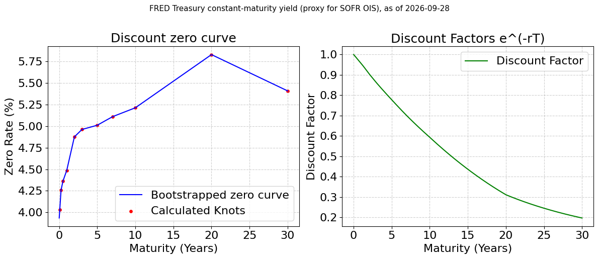

## 4. Calibration

### 4.1 The fit

Heston is fitted to the 6M to 4.2Y quotes with a vol-space objective weighted by 1/(bid-ask vol spread)^2 and one vote per expiry, then scored on everything including the 1M and 3M slices it never saw. Prices come from the Lewis (2001) characteristic-function integral on an FFT grid with a cubic spline in strike; the implied-vol inversion is a vectorised bisection.

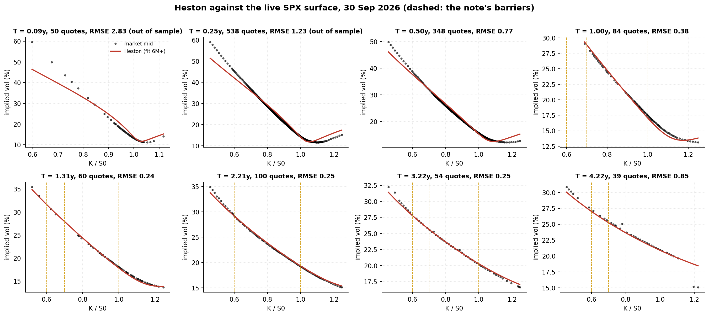

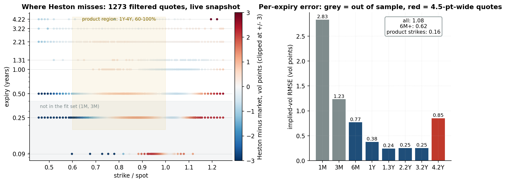

| Region | Vol RMSE | Why |
|---|---|---|
| 1M, 3M (out of sample) | 2.8, 1.2 | a single diffusion cannot build the short-dated skew; Bates and double Heston get 1.2 / 0.4 at 1M |
| 6M | 0.77 | the first slice in the fit set, still some short-end curvature |
| 1Y to 3.2Y | 0.24 to 0.38 | inside the quote width |
| 4.2Y | 0.85 | quotes 4.5 vol points wide; every model lands here |
| Note's strike region, 1Y to 4Y at 60% to 100% | 0.16 | what the price depends on |

### 4.2 Which objective

Six objectives, same model, same quotes. A price objective (what v1 used) wins on price RMSE because it chases the expensive long-dated ATM options, and loses everywhere else. Relative price error over-weights deep OTM wings and blows the fit up. The spread-weighted vol objective is the best balance for a product whose value sits at 60% to 100% strikes, 1 to 4 years out.

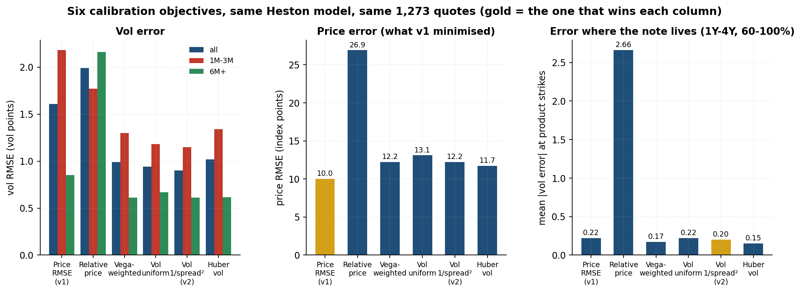

### 4.3 Which optimiser

The v2 default is differential evolution followed by L-BFGS-B. Eleven alternatives were run on the same problem with two seeds each. Everything that polishes locally from a sensible start finds the same optimum. `least_squares` with the residual vector (a Gauss-Newton trust-region method) gets there in 0.9 s, 70 times faster than the global search, because the problem is a smooth nonlinear least-squares fit with five parameters.

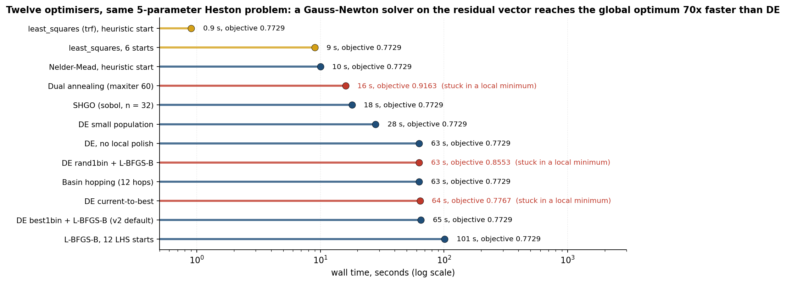

### 4.4 Which pricing engine

The Lewis FFT plus spline is accurate to 0.05 vol points, which is enough for the calibration but not for free. Carr-Madan with alpha 1.5 and the COS method (Fang and Oosterlee) are 100 times more accurate at the same cost. The Heston 1993 two-integral form and a badly damped Carr-Madan both break down deep out of the money.

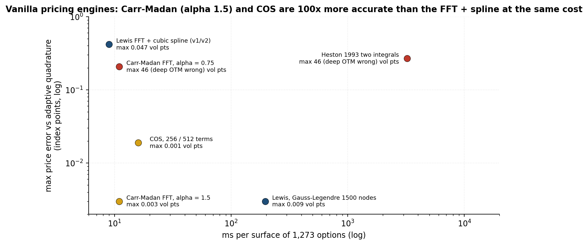

### 4.5 The Feller condition

The fitted sigma grew with every refinement of the objective (1.19 in v1, 1.53 in v2 live), so 2 kappa theta / sigma^2 fell to 0.13 and 42% of simulated days sit at zero variance. This was investigated as a possible bug. It is not one: no model price sits below the intrinsic bound (which would floor the vol inversion), the COS engine finds the same optimum, and the kappa-sigma ridge has a real minimum. Vol-space objectives see the wings, and the only tool Heston has for wing curvature is sigma. Enforcing Feller through the reparametrisation sigma = s sqrt(2 kappa theta) costs two vol points of fit everywhere and moves the note from 975.4 to 970.9.

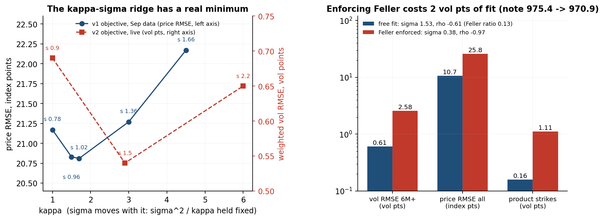

### 4.6 Other models

Bates (lognormal jumps), double Heston (Christoffersen, Heston and Jacobs) and rough Heston (El Euch and Rosenbaum, solved with the Gatheral-Radoicic rational approximant of the fractional Riccati equation and checked against a fractional Adams solver) were calibrated to all eight expiries with the same objective. Each one was also run through the same Monte Carlo on the same paths.

| Model | Parameters | Vol RMSE all / 1M-3M / 6M+ | Price RMSE | Note price (s.e.) | Calibration |
|---|---|---|---|---|---|
| Heston, fit to all | 5 | 0.90 / 1.15 / 0.61 | 12.2 | 976.4 (0.69) | 35 s |
| Heston, fit to 6M+ (the default) | 5 | 1.08 / 1.44 / 0.615 | 10.7 | 975.4 (0.70) | 30 s |
| Bates | 8 | 0.42 / 0.47 / 0.36 | 9.9 | 975.9 (0.70) | 78 s |
| Double Heston | 10 | **0.22 / 0.17 / 0.25** | **8.9** | 976.4 (0.69) | 132 s |
| Rough Heston (H = 0.33) | 6 | 0.80 / 0.99 / 0.58 | 11.8 | | 263 s |

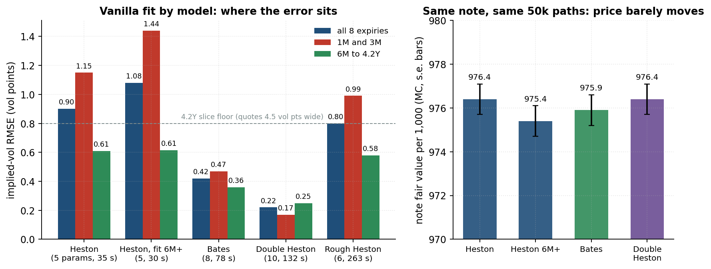

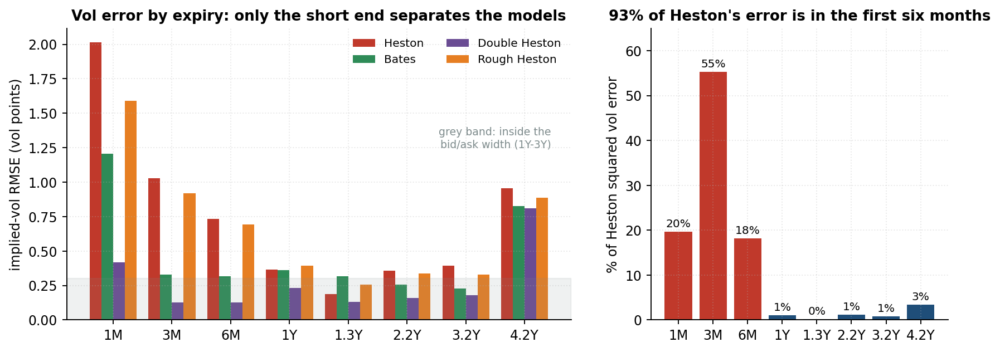

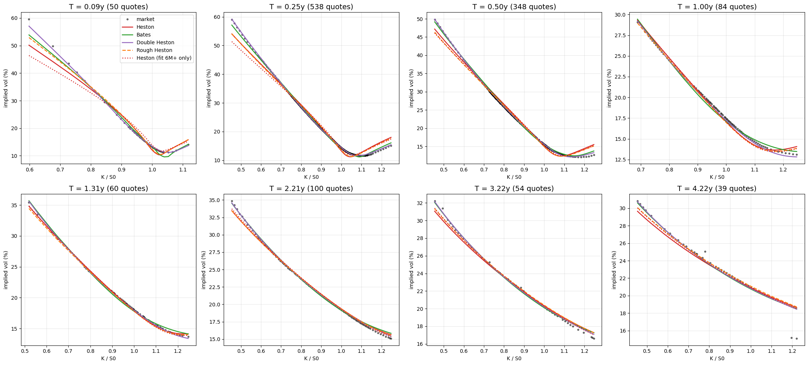

## 5. Pricing and validation

### 5.1 Monte Carlo

Andersen's quadratic-exponential scheme with martingale correction, daily steps, the (r - q) drift read from the curves per step, observation dates placed on the grid, and the 7-day payment lag discounted separately. 50,000 paths give a standard error of 0.70 per 1,000. Control variates (a 1Y digital, the 4Y 60% put, the 4Y digitals) double the efficiency; Sobol with a Brownian bridge hurts on this digital-heavy payoff. Euler with full truncation is cheaper per path but biased by 5.4 at monthly steps, where QE is off by 1.7.

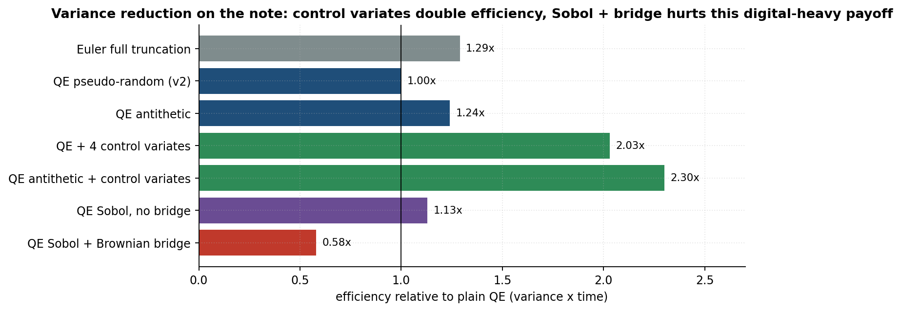

### 5.2 Finite differences

`pde_heston.py` solves the two-dimensional Heston PDE in (log spot, variance) backward in time with the Craig-Sneyd ADI scheme, Rannacher restarts after each digital, a non-uniform grid with nodes on the three barriers and a sinh-stretched variance axis, and the autocall as jump conditions on the observation dates. The three legs are solved as separate PDEs and add to the total. One solve takes about four seconds, so delta and gamma are read straight off the grid and the other Greeks come from bumped re-solves.

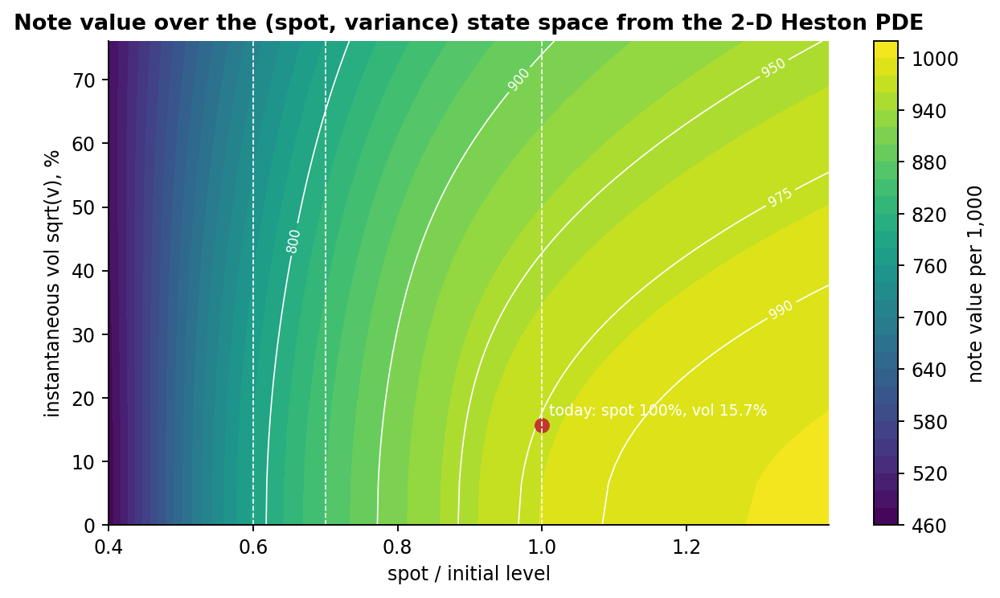

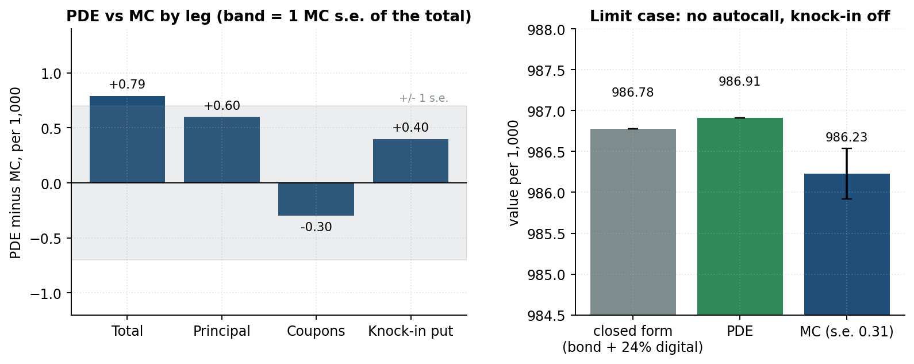

### 5.3 Validation suite

Every check is a cell in `main.ipynb`.

| Check | Result |
|---|---|
| Characteristic function forward identity, phi(-i) = exp((r - q) T) | exact to 1e-15 at every expiry |
| FFT plus spline against adaptive quadrature | within 0.004 index points from 1Y out, 0.04 at 1M |
| Martingale test, E[S_t] / F(t) - 1 | within about one standard error at 0.25, 1, 2, 3 and 4 years |
| Vanilla repricing, Monte Carlo against FFT, 60% to 110% strikes at 1Y and 4Y | largest gap 1.6 s.e. |
| Step-size convergence, 12 / 52 / 252 steps a year | Euler and QE agree at daily steps |
| Path convergence, 25k to 200k paths | s.e. x sqrt(n) constant at 154 to 156 |
| Limit case, no autocall and knock-in off, against the closed-form bond plus 24% digital | MC 986.23 (s.e. 0.31), PDE 986.91, closed form 986.78 |
| Pure bond limit | exact, 817.94 |
| Independent implementation, 2-D PDE on a 509 x 80 grid | note 976.19 against MC 975.40; legs within 0.8; grid refinement 976.5, 976.2, 976.0 |

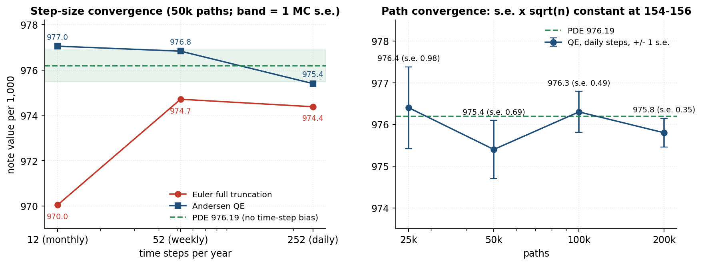

## 6. Risk: Greeks, hedging costs, model risk

### 6.1 Greeks

Client seat, per 1,000 notional. The PDE values are the reference. Monte Carlo bump-and-reprice on 100,000 common-random-number paths agrees once the spot bumps are wide enough (the first attempt with 1% bumps on 50,000 paths produced a gamma of -3 that was pure noise).

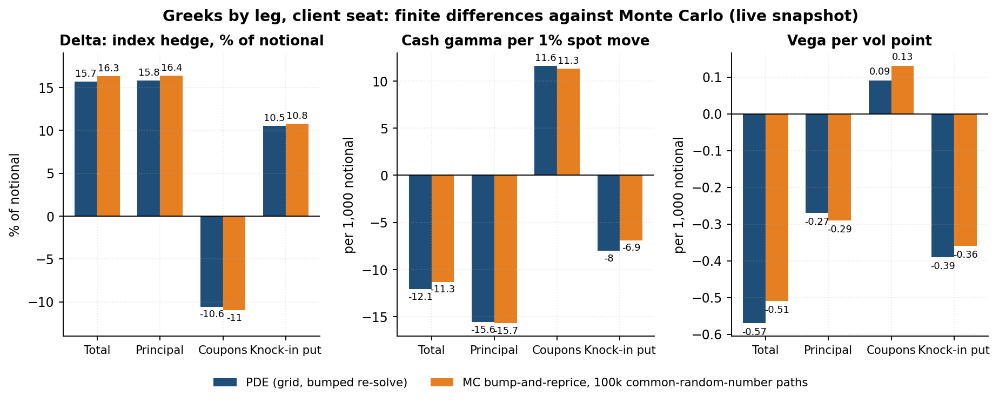

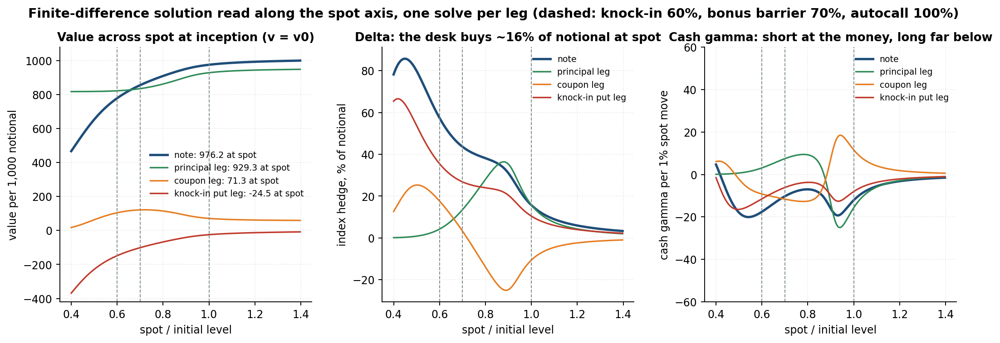

The client is long delta (the desk buys about 16% of notional in index), short gamma at the money, and short vega. The correlation sensitivity of the whole note is small and driven by autocall timing rather than by the put: a flatter skew delays year-1 calls, which lowers the principal leg and raises the coupon leg, and the two nearly cancel.

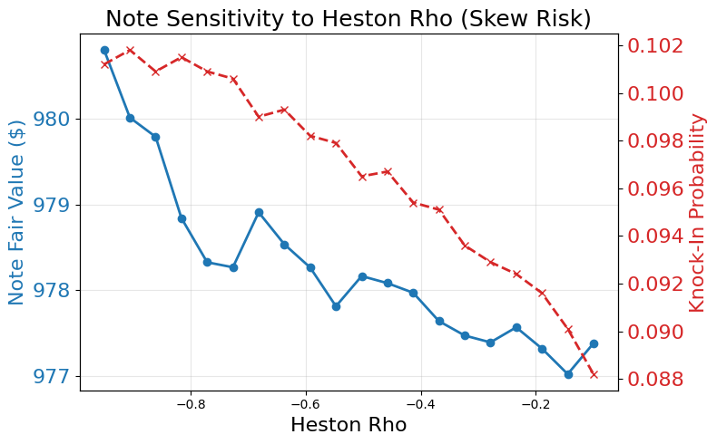

<details>
<summary>European call sensitivities under Heston against Black-Scholes, full strike range, eight expiries</summary>

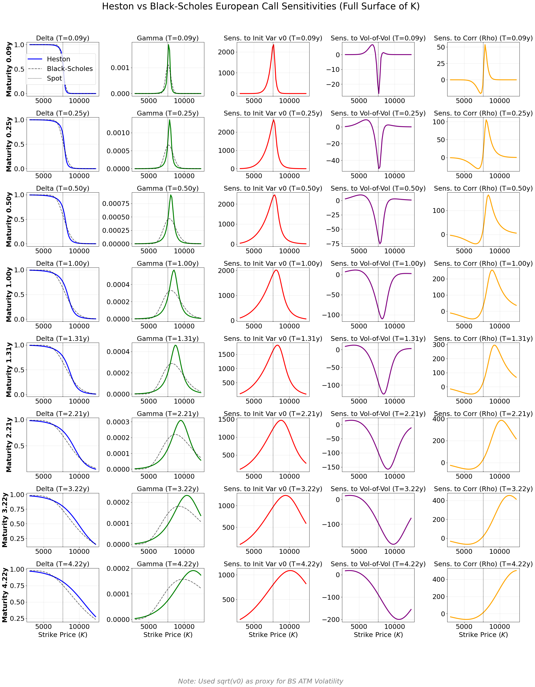

</details>

### 6.2 Hedging costs and structure sensitivities

Paired differences on 100,000 paths with common random numbers, base 976.34. As a percentage of notional in the client's seat; the desk sees the mirror image.

| Change | Note value |
|---|---|
| Autocall level 100% to 99% / 101% | +0.092% / -0.099% |
| Bonus barrier 70% shifted 1% down / up | +0.023% / -0.024% |
| Knock-in 60% shifted 1% down / up | +0.034% / -0.029% |
| All three barriers 1% against the desk | +0.147% (fair coupon 3.99% to 3.94%) |
| Coupon +10 bp per semester | +0.239% (+0.024% per bp) |
| Autocall digitals as 1% / 2% / 5% call spreads | +0.048% / +0.093% / +0.229% |
| All digitals as 2% / 5% spreads | +0.146% / +0.347% |
| Payment lag 0 / 14 days instead of 7 | +0.093% / -0.093% |
| Knock-in observed daily instead of at maturity | -0.850% |
| Dividend yield +10 bp | -0.042% |
| All observation dates +5 days | -0.123% |
| Rates +10 bp, discounting only | -0.146% |
| Vega-hedge crossing cost on the 4.2Y 60% put | about 0.11% |
| Model-risk reserve, local vol against LSV | 1.27% |

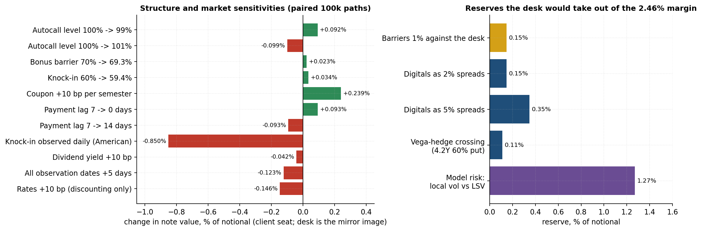

Coupon sensitivity is linear over the range that matters, which is what makes the fair-coupon solve a one-dimensional root find on common random numbers.

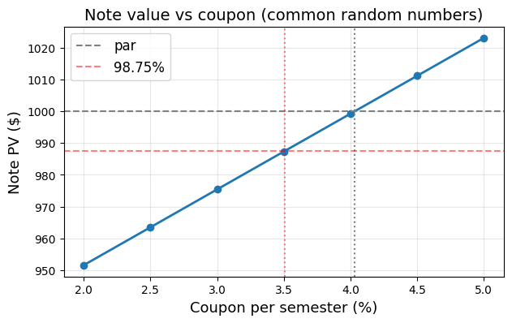

### 6.3 Model risk from the dynamics

Local vol (Dupire on arbitrage-free SVI slices) and local-stochastic vol (Heston with a particle-method leverage function, quantile bins and a local-linear conditional expectation) both reprice the vanilla surface within about half a vol point. They disagree by 12.7 per 1,000 on the note, because local vol flattens the forward skew and makes the knock-in more likely. That is the quantity a desk reserves against. The stochastic-vol models among themselves sit within one point of each other, inside Monte Carlo noise.

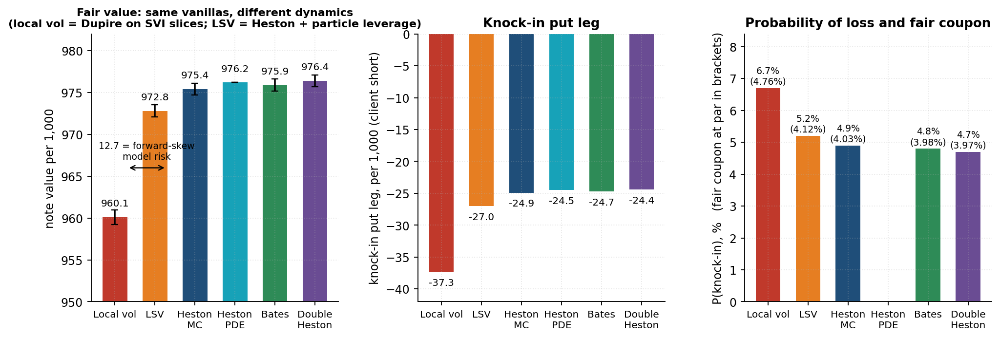

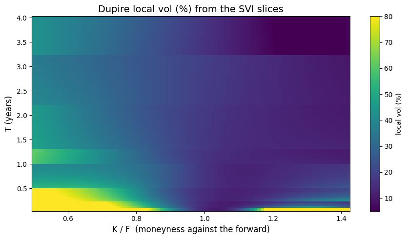

### 6.4 Where the paths end

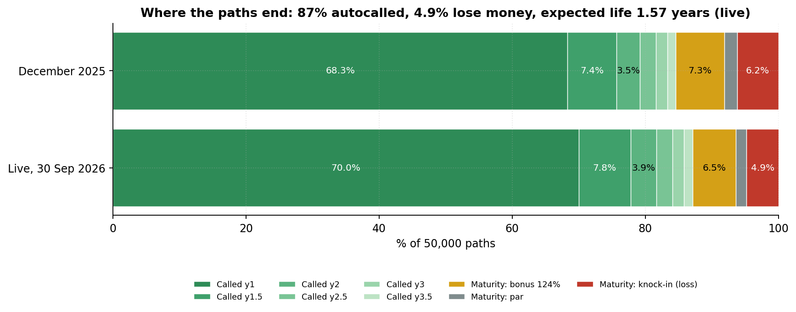

| | Live, 30 Sep 2026 | December 2025 |
|---|---|---|
| Autocall at year 1 | 70.0% | 68.3% |
| Autocall at any date | 87.0% | 84.6% |
| Reach maturity: bonus / par / knock-in | 6.5% / 1.6% / 4.9% | 7.3% / 1.9% / 6.2% |
| Mean final level given knock-in | 38% | 36.5% |
| Expected life | 1.57 years | 1.64 years |

## 7. From version 1 to version 2

Version 1 is the December 2025 course submission, kept untouched in `original_submission/` and reproduced exactly in `v1_benchmark.ipynb` (kappa 2.4095, theta 0.0548, sigma 1.1947, rho -0.7226, v0 0.0310; price RMSE 13.29 on 906 quotes; 986.83 with seed 42, submission 987.53 unseeded). Version 2 changed the following.

| | Version 1 | Version 2 |
|---|---|---|
| Quotes | 906, unfiltered | call-spread no-arbitrage filter with bid/ask attached; 1,273 kept on the live data |
| Objective | price RMSE on all expiries | 1/spread^2 vol RMSE on 6M+, one vote per expiry; 1M and 3M held out |
| Rates | flat drift from one zero | term-structure drift per step from the bootstrapped curve |
| Scheme | Euler, full truncation | Andersen QE with martingale correction |
| Observation dates | nearest grid point | placed on the grid; 7-day payment lag discounted |
| Validation | standard error | the nine checks in section 5.3, plus the PDE |
| Greeks | bump-and-reprice | PDE grid Greeks per leg, MC as a cross-check |
| Price (December data) | 986.83 (s.e. 0.79) | 986.13 (s.e. 0.79) |

On the live data with the same random numbers, the steps attribute as follows. The scheme and the calibration each add about one point and the payment lag takes one back. Discounting 25 bp lower (a SOFR OIS curve rather than the Treasury proxy) would be worth 3.7, more than all the modelling changes together.

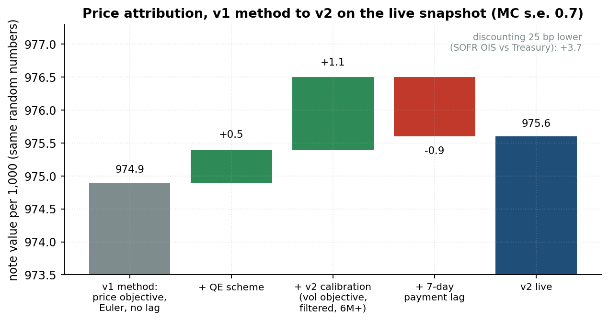

The quote filter and the QE scheme were also applied to version 1 on its own December data (`v1_benchmark.ipynb`, section 7): the parameters barely move, price RMSE falls from 13.29 to 11.44, and the gap to the PDE shrinks from 1.8 to 1.3 standard errors. The gain at the note's strikes (0.22 to 0.16 vol points) comes from the vol objective and the fit set, not from the filter or the scheme.

## 8. Repository map

| Path | What it is |
|---|---|
| `main.ipynb` | the v2 pipeline on the live snapshot: data, curve, calibration, Monte Carlo, validation including the PDE, attribution, fair coupon, hedging costs, Greeks |
| `main_2025-12-03_snapshot.ipynb` | the same pipeline on the December 2025 data |
| `model_comparison.ipynb` | Heston, Bates, double Heston, rough Heston on the same quotes and paths |
| `methods_comparison.ipynb` | engines, implied-vol solvers, objectives, optimisers, expiry rule, variance reduction, SSVI against SVI, Dupire, local vol and LSV |
| `v1_benchmark.ipynb` | the December submission reproduced exactly, then PDE, QE and the quote filter on its conventions |
| `v1_september_full.ipynb` | every analysis on the September data with the v1 method as the baseline; results in `v1_september_facts.csv` |
| `heston_pricer.py` | curve bootstrap, quote hygiene, Lewis-FFT calibrator, Euler and QE engines (numba), the autocall pricer, Greeks |
| `vol_models.py` | Bates, double Heston and rough Heston characteristic functions; multi-model calibrator and Monte Carlo |
| `methods.py` | alternative engines, objectives, optimisers, variance reduction, SVI and SSVI, Dupire, the LSV particle engine |
| `pde_heston.py` | the 2-D Heston ADI solver with the autocall as jump conditions |
| `pull_live_data.py` | one-command re-pull of the SPX chain (yfinance) and the Treasury curve (FRED) |
| `calibration_data_*.xlsx`, `rates_*.csv` | the two market snapshots (cleaned quotes, raw chain, spot, implied dividends, rates) |
| `original_submission/` | version 1, untouched |
| `docs/` | `FACT_SHEET.md` (every number), `RESULTS_SUMMARY.md` (every experiment), the term sheet, the December report and slides |
| `figures/` | the charts in this README |

## 9. Reproduce

Python 3.10 or later. Tested on 3.13 with numpy 2.1, scipy 1.15, pandas 3.0, numba 0.61.

```bash
pip install -r requirements.txt
```

Run the notebooks in place; outputs are committed so they can also just be read.

```bash
jupyter nbconvert --execute --inplace main.ipynb
```

Approximate run times on a laptop: `main.ipynb` 5 minutes, `model_comparison.ipynb` 15 minutes, `methods_comparison.ipynb` 25 minutes, `v1_benchmark.ipynb` 10 minutes, `v1_september_full.ipynb` 60 minutes. Seeds are fixed (42) so the Monte Carlo numbers reproduce exactly.

To re-run on today's market, during US trading hours:

```bash
python pull_live_data.py
```

This writes a new `calibration_data_<date>.xlsx` and `rates_<date>.csv`; point `DATA_FILE` at the top of `main.ipynb` to the new file.

## 10. Caveats

- The discount curve on the live snapshot is a Treasury constant-maturity curve used as a proxy for SOFR OIS. It sits about 25 bp above OIS, which is worth 3.7 per 1,000 on the note. Swap in OIS quotes if you have them; `set_rate_curve` takes any list of (tenor, rate) pairs.
- Quotes come from the public yfinance chain. They are good to 1Y, serviceable to 3Y and 4.5 vol points wide at 4.2Y. A desk feed would tighten the long end and the 4.2Y error floor with it.
- Heston is kept as the production model for the price because it is the benchmark the project set out to build and its price is inside noise of the better-fitting models. For a desk, the recommendation in `methods_comparison.ipynb` is LSV for pricing with Heston as the benchmark, and the 1.27% local-vol-versus-LSV gap as the reserve.
- Greeks from Monte Carlo bump-and-reprice need 100,000 paths and spot bumps of 2% to 5% to be reliable on this payoff. Use the PDE values.

## 11. References

- Heston, S. (1993). A closed-form solution for options with stochastic volatility. *Review of Financial Studies*.
- Lewis, A. (2001). A simple option formula for general jump-diffusion and other exponential Levy processes.
- Carr, P. and Madan, D. (1999). Option valuation using the fast Fourier transform. *Journal of Computational Finance*.
- Fang, F. and Oosterlee, C. (2008). A novel pricing method for European options based on Fourier-cosine series expansions. *SIAM Journal on Scientific Computing*.
- Andersen, L. (2008). Simple and efficient simulation of the Heston stochastic volatility model. *Journal of Computational Finance*.
- in 't Hout, K. and Foulon, S. (2010). ADI finite difference schemes for option pricing in the Heston model with correlation. *International Journal of Numerical Analysis and Modeling*.
- Bates, D. (1996). Jumps and stochastic volatility. *Review of Financial Studies*.
- Christoffersen, P., Heston, S. and Jacobs, K. (2009). The shape and term structure of the index option smirk. *Management Science*.
- El Euch, O. and Rosenbaum, M. (2019). The characteristic function of rough Heston models. *Mathematical Finance*.
- Gatheral, J. and Radoicic, R. (2019). Rational approximation of the rough Heston solution. *International Journal of Theoretical and Applied Finance*.
- Gatheral, J. and Jacquier, A. (2014). Arbitrage-free SVI volatility surfaces. *Quantitative Finance*.
- Guyon, J. and Henry-Labordere, P. (2012). Being particular about calibration. *Risk*.
- Dupire, B. (1994). Pricing with a smile. *Risk*.

Course project for the Columbia MAFN programme (December 2025 submission), reworked and extended in September and October 2026.
